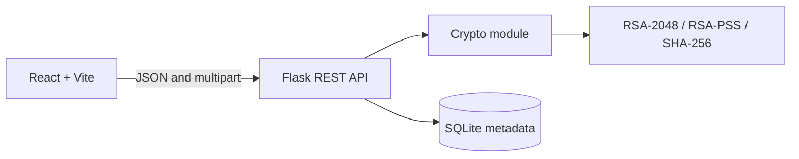
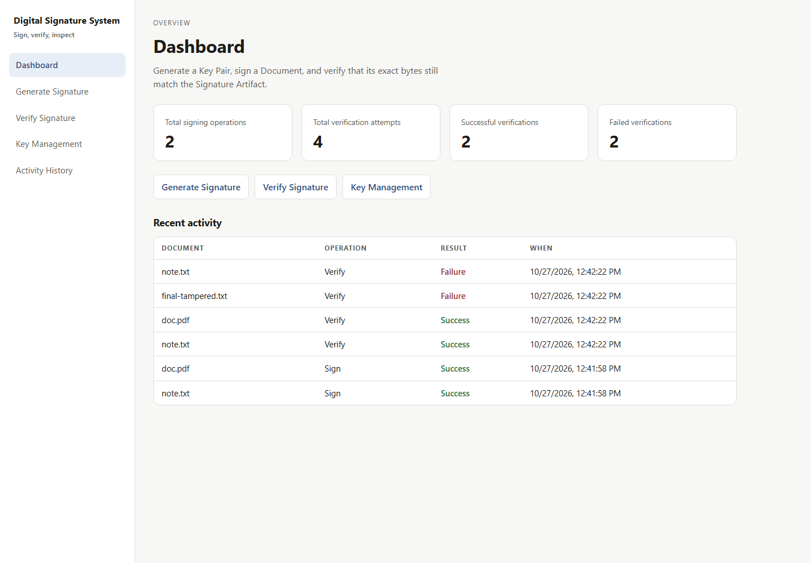
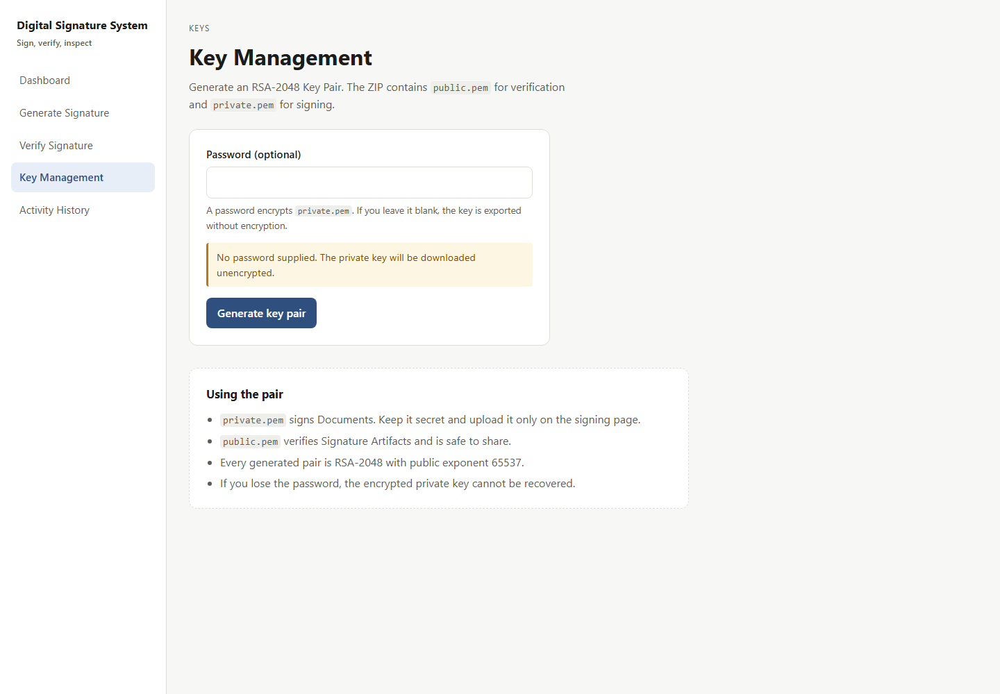
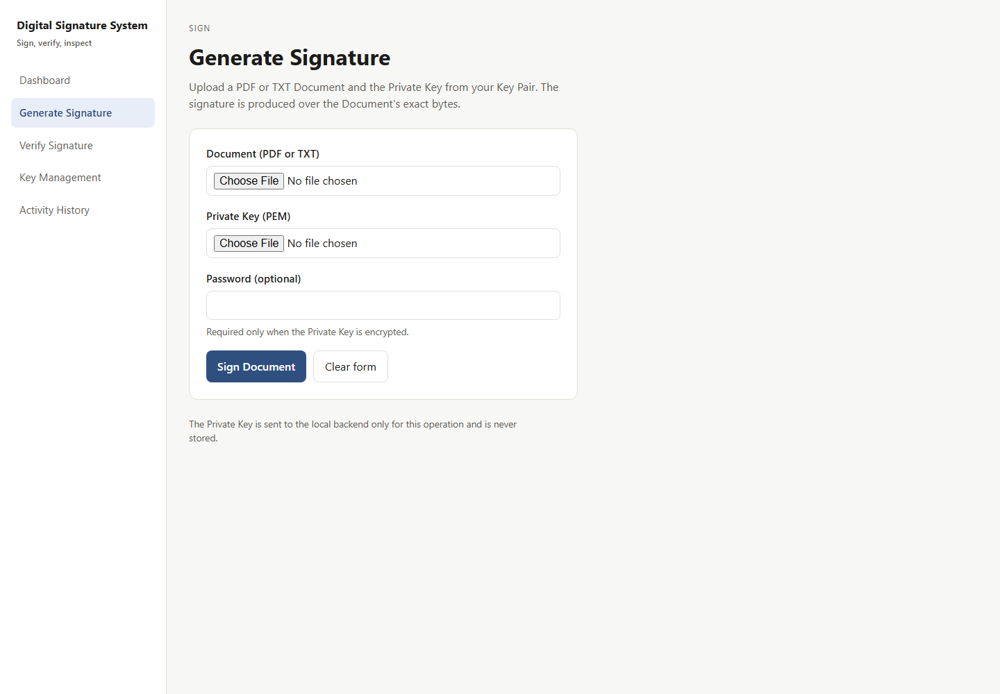
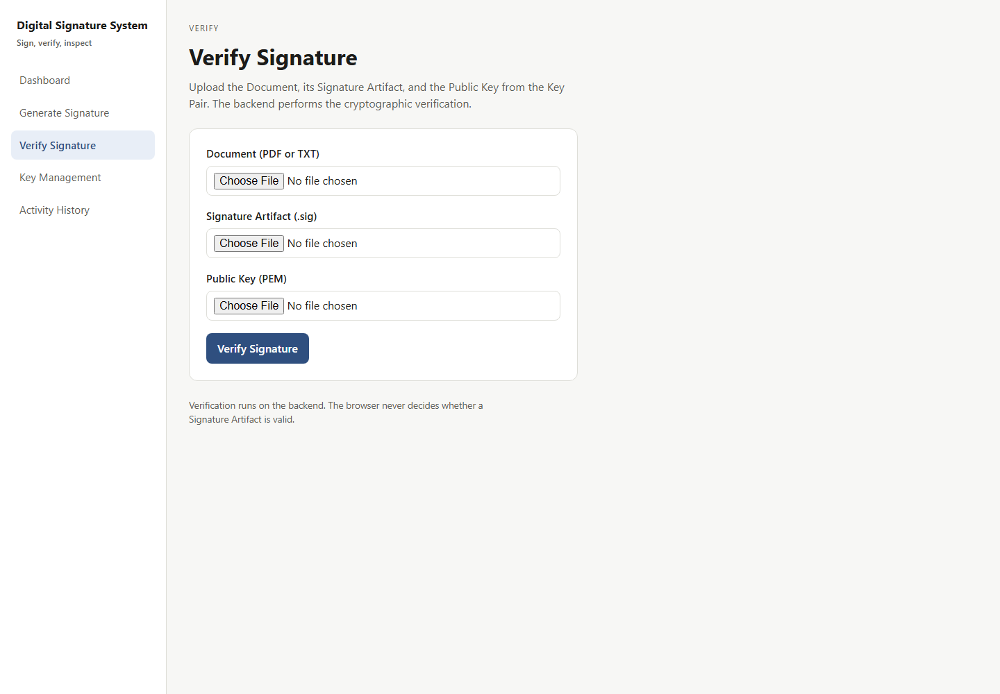
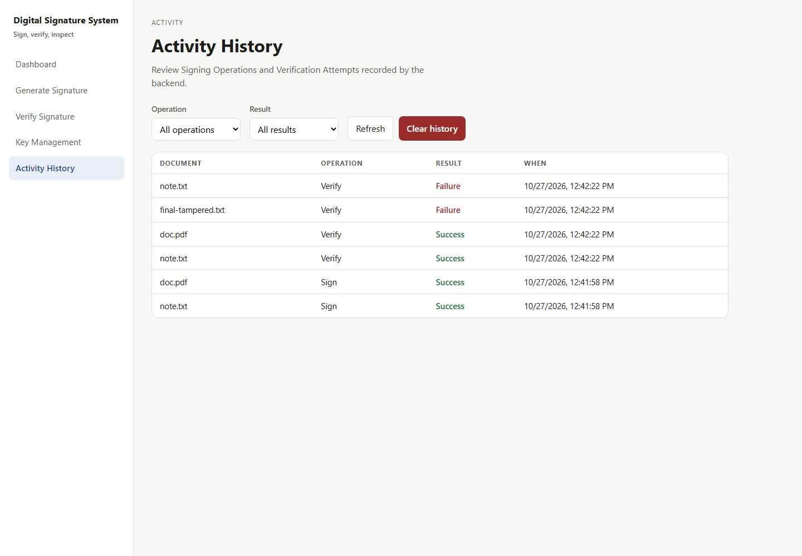

# Digital Signature Generation and Verification System

A local full-stack course project for producing and checking digital signatures over PDF and TXT documents. A signer selects a Private Key; a recipient verifies the Document, Signature Artifact, and Public Key. The backend performs every cryptographic operation and is the sole authority on Valid or Invalid.

## Features

- RSA-2048 Key Pair generation with optional password-encrypted Private Key export.
- Signing PDF and TXT Documents over their original bytes.
- Downloadable raw `.sig` Signature Artifacts.
- Backend verification with an honest Valid/Invalid result and Document Fingerprint.
- TXT tamper demonstration: edit one character and watch verification fail.
- Dashboard with four live counts and recent activity.
- Activity History with operation/result filters, refresh, and confirmed clear-all.
- Metadata-only SQLite history; no Private Keys, Passwords, or document contents.

## Tech stack

| Layer | Technology |
| --- | --- |
| Frontend | React 19, Vite 8, React Router 7, CSS Modules |
| Backend | Python 3.12, Flask 3.1 |
| Cryptography | `cryptography` 50, RSA-2048, RSA-PSS, SHA-256 |
| Database | SQLite |
| Tests | Pytest, Vitest + React Testing Library |

## Architecture



- **Frontend** owns forms, uploads, downloads, and rendering. It never performs cryptography or decides validity.
- **API** owns validation, orchestration, error mapping, and Operation Records. Route handlers do not contain cryptographic primitives.
- **Crypto module** owns key generation, PEM serialization, signing, and verification.
- **SQLite** stores Operation Records only: filename, operation type, result, reason code, algorithm, fingerprint, and timestamp.

In development, Vite proxies `/api` to Flask. In single-origin mode, Flask serves the built frontend and the API from port 5000.

## Cryptography

- RSA-2048 with public exponent `65537`.
- RSA-PSS with SHA-256, MGF1-SHA-256, and `PSS.MAX_LENGTH`, identical for signing and verification.
- Signing always covers the Document's original bytes — never a filename, path, or frontend-computed hash.
- Private Keys export as PKCS#8 PEM; Public Keys as SubjectPublicKeyInfo PEM.
- A supplied Password encrypts the Private Key with `BestAvailableEncryption`; a blank Password exports it unencrypted with a visible warning.
- Imported keys must be RSA-2048.
- RSA-PSS is randomized, so two signatures over the same bytes differ while both verify.

Verification proves that a Signature Artifact matches a Document and a supplied Public Key. It does **not** prove who owns that key; see [ADR-0001](docs/adr/0001-single-verification-failure-category.md) and [Limitations](#limitations-and-future-work).

## Prerequisites

Verified on Windows 11 with PowerShell 5.1:

- Python 3.12.10
- Node.js 24.19.0
- npm 11.17.0

## Setup

From the repository root:

```powershell
python -m venv backend\.venv
backend\.venv\Scripts\python.exe -m pip install -r backend\requirements.txt
```

Install frontend dependencies:

```powershell
cd frontend
npm install
cd ..
```

## Run

### Development (two servers)

Terminal 1, from the repository root:

```powershell
backend\.venv\Scripts\python.exe backend\app.py
```

Terminal 2, from the repository root:

```powershell
cd frontend
npm run dev
```

Open <http://localhost:5173>. Vite proxies `/api` to `http://127.0.0.1:5000`.

### Single-origin demo (Flask serves the build)

```powershell
cd frontend
npm run build
cd ..
backend\.venv\Scripts\python.exe backend\app.py
```

Open <http://127.0.0.1:5000>. Client-side routes such as `/sign` fall back to `index.html`; unknown `/api/...` paths return JSON 404. If the build is missing, `/` returns a JSON error telling you to run `npm run build`.

## Workflow

1. **Key Management** (`/keys`) — generate an RSA-2048 Key Pair, optionally enter a Password, download `rsa-keypair.zip`, and extract `public.pem` and `private.pem`.
2. **Generate Signature** (`/sign`) — upload a PDF or TXT Document, the `private.pem`, and the Password if it is encrypted. Download the `.sig` file.
3. **Verify Signature** (`/verify`) — upload the same Document, the `.sig`, and `public.pem`. The backend returns Valid or Invalid.
4. **Tamper demonstration** (`/verify`, TXT only) — edit the prefilled text and re-verify against the same `.sig`; Invalid is expected and recorded.
5. **Dashboard and History** (`/`, `/history`) — inspect counts, recent activity, filters, and clear history after confirmation.

## API

All endpoints are under `/api`. Errors use:

```json
{ "error": { "code": "missing_input", "message": "A Document is required." } }
```

| Method | Endpoint | Input | Success |
| --- | --- | --- | --- |
| GET | `/api/health` | none | `200 {"status":"ok"}` |
| POST | `/api/keys/generate` | optional multipart `password` | `200` ZIP with `public.pem` and `private.pem` |
| POST | `/api/sign` | multipart `document`, `private_key`, optional `password` | `200` metadata + base64 Signature Artifact |
| POST | `/api/verify` | multipart `document`, `signature`, `public_key` | `200` with `valid`, `reason`, `message`, fingerprint |
| GET | `/api/history` | optional `operation=sign\|verify`, `result=success\|failure` | `200 {"records":[...]}` newest first |
| DELETE | `/api/history` | none | `200 {"deleted":<count>}` |
| GET | `/api/dashboard/stats` | none | `200` four counts + `recent_activity` |

Signing response fields: `operation_id`, `document_filename`, `document_size`, `document_sha256`, `algorithm`, `signed_at`, `signature_filename`, `signature_base64`. Base64 is transport only; the downloaded artifact is raw binary.

Verification returns HTTP 200 with `valid: false` for an ordinary cryptographic mismatch. Requests rejected before cryptography return 4xx and are not recorded.

### Reason codes

| Code | Status | Meaning |
| --- | --- | --- |
| `missing_input` | 400 | A required file is missing |
| `unsupported_type` | 415 | Not PDF/TXT, or a PDF without `%PDF-` magic bytes |
| `file_too_large` | 413 | Request, Document, key, or signature exceeds its limit |
| `invalid_public_key` | 400 | Not an RSA-2048 PEM Public Key |
| `invalid_signature_format` | 400 | Empty Signature Artifact |
| `invalid_private_key` | 400 | Not an RSA-2048 PEM Private Key |
| `invalid_private_key_password` | 422 | Encrypted key without a usable Password |
| `invalid_filter` | 400 | Unknown history filter value |
| `verification_failed` | 200 | Cryptographic mismatch; `valid: false` |
| `internal_error` | 500 | Generic failure with no stack trace or internal path |

`verification_failed` deliberately covers a modified Document, the wrong Public Key, and the wrong Signature Artifact. RSA-PSS cannot distinguish them.

## Upload limits

- 12 MB total request.
- 10 MB per Document.
- 64 KB per Private Key, Public Key, and Signature Artifact.
- Uploads stream to temporary files and are removed in a `finally` path.

## Security

- The app never persists, logs, or commits Private Keys or Passwords.
- The Private Key is returned only inside the generated ZIP and is never displayed in full or written to browser storage.
- The backend decides validity; the frontend only renders the response.
- SQLite access uses parameterized queries and stores metadata only.
- Flask runs with `debug=False`; unexpected errors return a generic JSON envelope.
- The demo is single-origin, so no permissive CORS is configured.
- Identity verification, authentication, certificates, cloud key storage, blockchain, and third-party APIs are out of scope.

## Testing

```powershell
cd backend
.venv\Scripts\python.exe -m pytest
cd ..\frontend
npm test
npm run build
```

Actual results on 2026-10-27:

| Command | Result |
| --- | --- |
| Backend Pytest | **69 passed** |
| Frontend Vitest | **31 passed** across 7 test files |
| Frontend production build | **pass** (39 modules) |

The backend suite covers crypto parameters, key round trips, signing/verification, upload limits, error envelopes, history filters, aggregates, clear-all, and JSON 404 behavior. The frontend suite covers navigation, all five pages, validation, downloads, backend-driven results, the tamper editor, history filters, and clear confirmation.

### End-to-end verification

Executed against the single-origin build at `http://127.0.0.1:5000` with fresh keys:

| Step | Result |
| --- | --- |
| Generate Key Pair | ZIP with `public.pem` and `private.pem` |
| Sign `note.txt` | Operation 1, `.sig` produced |
| Sign `doc.pdf` | Operation 2, `.sig` produced |
| Verify original TXT | `valid: true` |
| Verify original PDF | `valid: true` |
| Verify tampered TXT | `valid: false`, `verification_failed` |
| Verify with wrong Public Key | `valid: false`, `verification_failed` |
| Dashboard statistics | 2 signings, 4 verifications, 2 successful, 2 failed |
| Database | 6 Operation Records, metadata only |
| Single-origin SPA | `/` and `/sign` return HTML; `/api/health` returns JSON |
| Unknown API path | `404` JSON `not_found` |

The optional Playwright suite was not adopted. End-to-end checks used `curl` against the real servers, and screenshots were captured with headless Chrome at 1440×1000.

## Screenshots











## Project structure

```text
backend/
  app.py                 Flask app factory, limits, SPA serving
  crypto_utils.py        RSA keys, PEM, signing, verification
  database.py            SQLite schema and queries
  uploads.py             shared upload and Document validation
  api_errors.py          ApiError and JSON error envelope
  routes/                keys, signing, verification, history
  tests/                 Pytest suites
frontend/
  src/components/        Sidebar, OperationTable, placeholders
  src/lib/               label formatting
  src/pages/             Dashboard, Sign, Verify, Keys, History
  src/styles/            global CSS
  vite.config.js         proxy and Vitest configuration
docs/
  adr/                   architecture decisions
  agents/                issue tracker and domain guidance
  screenshots/           README images
.scratch/                local spec and tickets
CONTEXT.md               domain glossary
AGENTS.md                agent guidance
plan.txt                 original product and security specification
```

## Limitations and future work

- **Signer identity is not proven.** Verification proves key match, not ownership. Certificates or a trusted directory would be required.
- **Invalid does not diagnose the cause.** A modified Document, wrong Public Key, and wrong Signature Artifact are indistinguishable by design.
- No authentication, user accounts, or multi-user isolation.
- No pagination or retention policy for Operation Records.
- Local-only: no HTTPS, reverse proxy, or deployment hardening.
- The optional Playwright suite was not adopted; browser checks were manual/headless.

## Documentation

- `plan.txt` — authoritative product and security specification.
- `CONTEXT.md` — domain glossary.
- `docs/adr/` — hard-to-reverse decisions.
- `.scratch/digital-signature-system/spec.md` — buildable spec.
- `.scratch/digital-signature-system/issues/` — tracer-bullet tickets with blocking edges.
